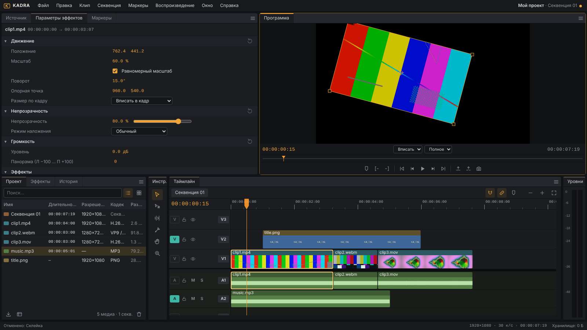

# Kadra — бесплатный видеоредактор в браузере

Kadra — нелинейный видеоредактор с рабочим процессом профессиональной монтажки
(Project → Source → Timeline → Program), который работает **полностью в браузере**:
импорт, монтаж, превью и экспорт MP4 выполняются на устройстве пользователя.
Сервер не нужен; необязательный бэкенд (FastAPI) хранит проекты и медиа, чтобы
открыть их на другом устройстве.

**Всё бесплатно**: без подписок, лимитов, водяных знаков, «pro-функций» и платёжной логики.



> Этап 1 — ядро редактора (этот репозиторий). Этап 2 — переходы, титры,
> цветокоррекция, эффекты и аудиообработка — подключается плагинами без
> переписывания движка (см. [docs/ARCHITECTURE.md](docs/ARCHITECTURE.md)).

---

## Структура репозитория

```
kadra/
├── web/                         ← фронтенд (статический, для GitHub Pages)
│   ├── index.html               ← import map с закреплёнными версиями CDN-библиотек
│   ├── config.js                ← URL сервера по умолчанию, адрес ядра FFmpeg.wasm
│   ├── css/                     ← тёмная тема и раскладка
│   └── js/
│       ├── main.js              ← точка входа
│       ├── app.js               ← действия (меню + горячие клавиши), диалоги, жизненный цикл проекта
│       ├── core/                ← модель данных, store, undo/redo, операции таймлайна, ключевые кадры
│       ├── engine/              ← композитинг, превью, аудио (WebAudio), транспорт, экспорт
│       ├── media/               ← импорт, анализ файлов, кэш (превью-спрайты, пики аудио)
│       ├── storage/             ← IndexedDB, автосохранение, JSON, клиент сервера
│       ├── plugins/             ← реестр плагинов — точка расширения этапа 2
│       ├── ui/                  ← докинг-панели, меню, диалоги, панели
│       └── workers/             ← воркер FFmpeg.wasm (запасной кодировщик)
├── server/                      ← необязательный бэкенд (FastAPI)
│   ├── app/                     ← API: аккаунты, проекты, медиаассеты
│   ├── tests/                   ← pytest
│   ├── requirements.txt         ← зафиксированные версии
│   └── .env.example
├── render.yaml                  ← Blueprint для Render
├── tests/e2e/                   ← сквозные тесты в браузере (Playwright)
├── docs/ARCHITECTURE.md         ← архитектура, модель данных, подключение этапа 2
├── docs/TEST_REPORT.md          ← результаты end-to-end проверки
└── .github/workflows/           ← деплой на GitHub Pages и CI
```

Сборщик не нужен: фронтенд — нативные ES-модули. Внешние библиотеки
подгружаются с jsDelivr с закреплёнными версиями:

| Библиотека | Версия | Зачем |
|---|---|---|
| [mediabunny](https://mediabunny.dev) | 1.62.1 | чтение контейнеров (MP4/MOV/WebM/MP3/WAV…), точное покадровое декодирование, запись MP4/WebM |
| @mediabunny/aac-encoder | 1.62.1 | WASM-кодировщик AAC для браузеров без нативного (например, Chrome на Linux) |
| @ffmpeg/core | 0.12.10 | запасной путь экспорта (libx264 + AAC), если WebCodecs недоступен |

## Запуск локально

Нужен любой статический HTTP-сервер (ES-модули не работают с `file://`):

```bash
cd web
python3 -m http.server 8080
# открыть http://localhost:8080
```

Рекомендуемые браузеры: Chrome / Edge 113+ (лучшая поддержка WebCodecs),
Firefox 130+, Safari 17+.

### Сервер (необязательно)

```bash
cd server
python3 -m venv .venv && source .venv/bin/activate
pip install -r requirements.txt
cp .env.example .env        # при необходимости отредактируйте
uvicorn app.main:app --reload --port 8000
# API-документация: http://localhost:8000/api/docs
```

В редакторе: **Файл → Сервер и вход…** → адрес `http://localhost:8000` →
«Регистрация». Затем **Файл → Сохранить на сервер** / **Открыть с сервера…**.
Можно раздавать и фронтенд с того же сервера: `FRONTEND_DIR=../web uvicorn app.main:app`.

### Тесты

```bash
# API сервера
cd server && pip install -r requirements-dev.txt && pytest -q

# Сквозные тесты в браузере (нужен ffmpeg для генерации тестовых роликов)
pip install -r tests/e2e/requirements.txt -r server/requirements.txt
python -m playwright install chromium
python tests/e2e/make_media.py /tmp/kadra-media
cd tests/e2e
python run_e2e.py /tmp/kadra-media /tmp/kadra-out   # 26 шагов сценария ТЗ
python cloud_e2e.py /tmp/kadra-media                  # синхронизация через сервер
```

## Деплой

### Фронтенд → GitHub Pages

1. Загрузите репозиторий на GitHub.
2. **Settings → Pages → Build and deployment → Source: GitHub Actions**.
3. Сделайте push в `main` — workflow `.github/workflows/pages.yml` опубликует каталог `web/`.
4. Редактор будет доступен по адресу `https://<user>.github.io/<repo>/`.

Без сервера всё работает локально (IndexedDB). Чтобы подставить адрес
сервера по умолчанию, укажите его в `web/config.js` (`serverUrl`).

### Сервер → Render

1. Отредактируйте в `render.yaml` переменную `CORS_ORIGINS` — адрес вашего
   GitHub Pages, например `https://<user>.github.io`.
2. Render Dashboard → **New → Blueprint** → выберите репозиторий → **Apply**.
   Render создаст веб-сервис `kadra-server` (корень `server/`), сгенерирует
   `SECRET_KEY` и подключит постоянный диск `/var/data` (SQLite + медиа).
3. После деплоя проверьте `https://kadra-server.onrender.com/api/health`.
4. Укажите этот адрес в `web/config.js` или в «Файл → Сервер и вход…».

Переменные окружения сервера:

| Переменная | По умолчанию | Назначение |
|---|---|---|
| `SECRET_KEY` | генерируется | подпись JWT-токенов (на Render — `generateValue`) |
| `CORS_ORIGINS` | `*` | разрешённые адреса фронтенда через запятую |
| `DATA_DIR` | `./data` | каталог SQLite и медиа (на Render — `/var/data`) |
| `DATABASE_URL` | SQLite в `DATA_DIR` | PostgreSQL: `postgres://…` (драйвер подставляется сам) |
| `STORAGE_DIR` | `DATA_DIR/assets` | где хранить медиафайлы |
| `MAX_UPLOAD_MB` | `4096` | максимальный размер одного файла (защита диска сервера) |
| `TOKEN_TTL_HOURS` | `720` | срок действия входа |
| `ALLOW_REGISTRATION` | `true` | разрешить регистрацию |
| `FRONTEND_DIR` | — | раздавать фронтенд с этого же сервиса |

> Постоянный диск на Render доступен на платных планах. На бесплатном плане
> (`plan: free`, без блока `disk`) сервер запустится, но данные пропадут при
> перезапуске — подходит только для пробы.

API: `POST /api/auth/register|login`, `GET /api/auth/me`,
`GET/PUT/DELETE /api/projects/{id}`, `GET /api/projects`,
`POST /api/assets` (дедупликация по SHA-256), `GET /api/assets/lookup?sha256=`,
`GET /api/assets/{id}` (с поддержкой Range), `DELETE /api/assets/{id}`.

## Реализовано (этап 1)

**Медиа и проект**
- Импорт MP4 / WebM / MOV / MKV, MP3 / WAV / M4A / OGG / FLAC, PNG / JPG / WebP: диалог (`Ctrl+I`), перетаскивание в окно, в панель «Проект» или сразу на таймлайн.
- Панель «Проект»: список с метаданными (длительность, разрешение, FPS, видео/аудиокодек, размер) и сетка превью с прокруткой при наведении; секвенции; поиск; свойства; переименование; удаление; «Создать секвенцию по клипу».
- Офлайн-медиа (например, после импорта JSON на другом устройстве) и «Связать медиа…».
- Файлы хранятся в IndexedDB (блобы), проект — JSON со ссылками на ключи. Автосохранение каждые 60 с и при скрытии вкладки; ручное — `Ctrl+S`; «Сохранить как», менеджер проектов (`Ctrl+O`), экспорт/импорт проекта в `.kadra.json`.

**Мониторы**
- «Источник»: собственный транспорт, J/K/L, In/Out исходника, вставка (`,`) и наложение (`.`), перетаскивание кадра / «только видео» / «только звук» на таймлайн, волна для аудиофайлов.
- «Программа»: композиция секвенции на Canvas, качество превью (полное / ½ / ¼), масштаб, мини-шкала с In/Out и маркерами, Lift (`;`) / Extract (`'`), экспорт кадра в PNG, рамка трансформации выделенного клипа (перемещение и масштаб мышью).

**Таймлайн**
- Дорожки V1–V3, A1–A3 (добавление/удаление/переименование), блокировка, скрытие видео, Mute/Solo, целевые дорожки (патчинг).
- Магнитное прилипание (`S`) к плейхеду, краям клипов, маркерам и In/Out; зум `Ctrl+колесо`, `+`/`-`, `\`; прокрутка; покадровый скраббинг по линейке.
- Перетаскивание клипов по времени и между дорожками (связанные видео+звук двигаются вместе), режим вставки с `Ctrl`, дублирование с `Alt`, выделение рамкой и с `Shift`.
- Обрезка краёв, ripple-обрезка (инструмент `B` или `Ctrl`), лезвие (`C`, `Shift` — все дорожки), `Ctrl+K` / `Ctrl+Shift+K`, `Q`/`W`, удаление и удаление со сдвигом, удаление промежутка, копировать/вставить/вставить со сдвигом, сдвиг на кадр `Alt+←/→`, скорость/длительность (`Ctrl+R`), включение/выключение (`Shift+E`), связь (`Ctrl+L`), совпадение кадра (`F`).
- Маркеры (`M`, имя, цвет, комментарий, длительность), панель «Маркеры», переходы `Shift+M` / `Ctrl+Shift+M`; точки входа/выхода (`I`/`O`/`X`).
- Undo/Redo через командную модель: 200 шагов, панель «История» с переходом к любому шагу; жест перетаскивания — один шаг.

**Параметры эффектов** (аналог Effect Controls): положение, масштаб (в т.ч. раздельный), поворот, опорная точка, масштаб по кадру, непрозрачность, 16 режимов наложения, громкость (дБ) и панорама; «скраббируемые» числа (`Shift` — ×10, `Ctrl` — ×0.1).

**Воспроизведение**: мастер-часы WebAudio, видео подстраивается под звук; J/K/L (1×–8× вперёд, назад покадрово), стрелки, Home/End, ↑/↓ — точки монтажа, `Ctrl+Shift+Пробел` — от входа до выхода; индикаторы уровня L/R с удержанием пиков. FPS секвенции: 24 / 25 / 30 / 50 / 60.

**Экспорт** (`Ctrl+M`): MP4 (H.264 + AAC) или WebM (VP9 + Opus); разрешение (как в секвенции, 4K, 1440p, 1080p, 720p, 480p, свой размер), FPS, битрейт видео и звука, вся секвенция или In→Out; движок WebCodecs (быстро) или FFmpeg.wasm (совместимость); прогресс с оценкой времени и отмена. Без сервера и водяных знаков.

**Интерфейс**: собственная тёмная тема; докинг-панели — вкладки перетаскиваются в другие группы и к краям, разделители меняют размеры, `` ` `` разворачивает панель, раскладка сохраняется; на экранах уже 900 px панели складываются в две группы вкладок. Горячие клавиши работают в любой раскладке клавиатуры (в т.ч. русской).

## Известные ограничения

- **Этап 2 не реализован намеренно**: каталог эффектов, переходов и титров пуст, ключевые кадры задаются только программно (движок их уже поддерживает).
- Обратное воспроизведение (`J`) — покадровое и без звука; при скорости ≠ 100 % звук меняет высоту тона.
- Звук файла декодируется целиком в память (~23 МБ на минуту стерео 48 кГц).
- Экспорт собирает файл в памяти: для длинных роликов в 4K нужен запас RAM. Путь FFmpeg.wasm медленный (в тесте ~4–5 кадров/с при 720p) и загружает ~32 МБ.
- Дробные частоты секвенции (23.976, 29.97) и drop-frame таймкод не поддерживаются (исходники с такими частотами импортируются нормально).
- Превью использует `<video>`, экспорт — точное декодирование WebCodecs: на исходниках с переменной частотой кадров возможно расхождение ±1 кадр.
- ProRes / HEVC зависят от поддержки браузером (обычно только Safari/macOS).
- Нет вложенных секвенций, мультикамеры, папок (bins) в «Проекте»; индикаторы — только мастер-шина.
- JSON проекта не содержит медиафайлов: на другом устройстве их нужно связать или использовать сервер.
- Браузер может перехватить некоторые сочетания (например `Ctrl+N`) — для них есть альтернатива (`Alt+N`), список: «Справка → Сочетания клавиш».
- Сервер рассчитан на один экземпляр (SQLite на диске); для нескольких экземпляров нужен PostgreSQL и общее файловое хранилище.

## Лицензии сторонних компонентов

mediabunny и @mediabunny/aac-encoder — MPL-2.0 (AAC-кодировщик основан на AAC-энкодере FFmpeg);
@ffmpeg/core — GPL-2.0-or-later (сборка FFmpeg с libx264). Библиотеки загружаются с CDN и не входят в репозиторий.
